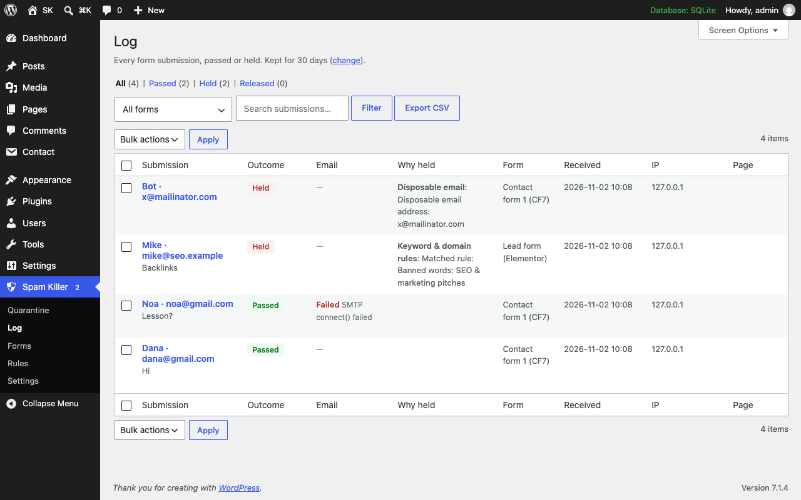
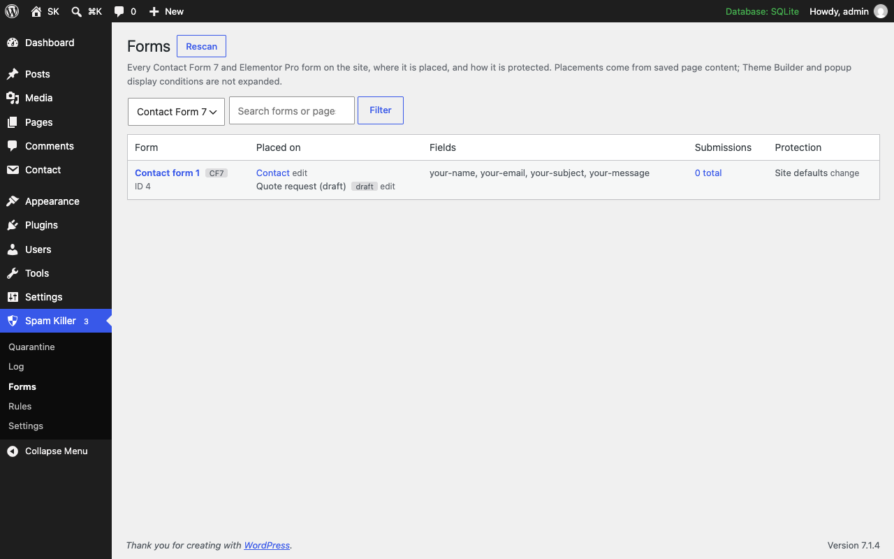
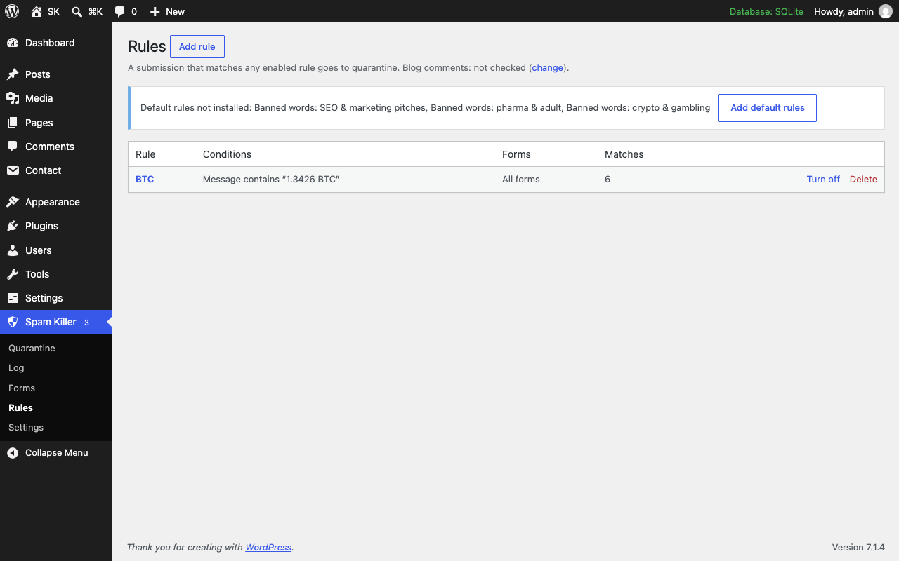
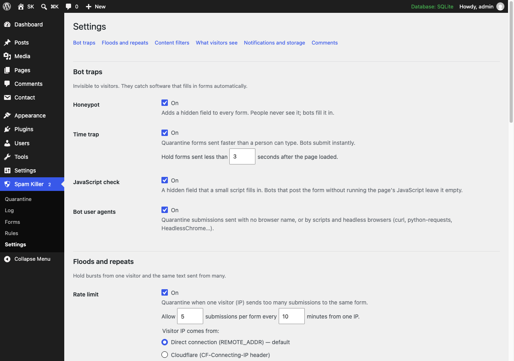
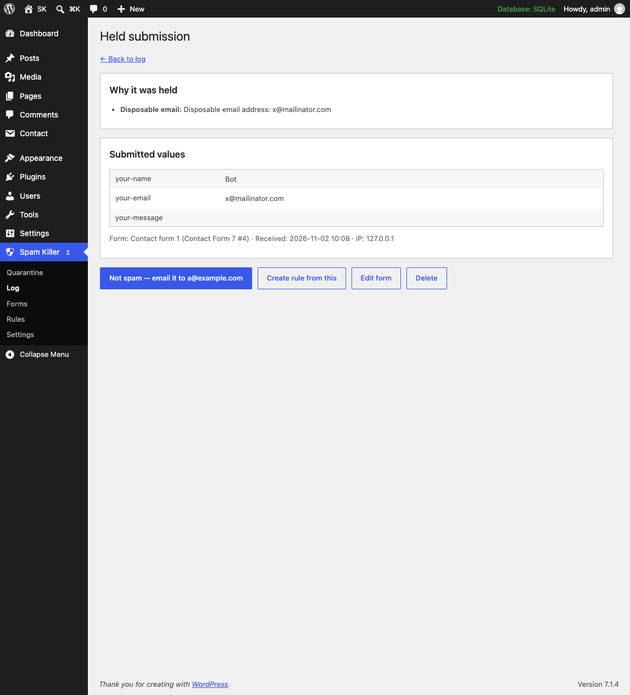

<div align="center">


<h1>Spam Killer</h1>

<p><strong>Spam never reaches your inbox. Real leads never get lost.</strong></p>

<p>A free WordPress anti-spam plugin for Contact Form 7 and Elementor Pro forms: no CAPTCHA, no cloud service, a quarantine you can review.</p>

<p>
  
  
  
  
</p>

<p>
  <a href="#install">Install</a> ·
  <a href="#what-it-does">What it does</a> ·
  <a href="#how-it-works">How it works</a> ·
  <a href="#why-not-akismet-cleantalk-or-recaptcha">Why not…?</a> ·
  <a href="#faq">FAQ</a>
</p>



<sub>The Log: every submission, why it was held, and whether its notification email was sent. Demo site, all data made up.</sub>

</div>

Your contact form sends you SEO pitches, crypto scams and bot junk, and the CAPTCHA you added annoys real visitors. Spam Killer checks every Contact Form 7 and Elementor Pro submission before any email goes out or any form action runs. Anything suspicious goes to a quarantine inbox instead of your mailbox, and you can release it with one click if it was a real lead.

## What it does

- **Catches bots without a CAPTCHA.** Hidden honeypot field, time trap (sent faster than 3 seconds), JavaScript check and bot user-agent check (curl, python-requests, headless Chrome, Puppeteer, Playwright).
- **Stops floods and copy-paste spam.** Rate limit per form per IP (default 5 per 10 minutes) and duplicate detection: a message ≥ 90% similar to one of the last 100 from another IP is held.
- **Filters content.** Disposable email domains ([bundled list](https://github.com/disposable-email-domains/disposable-email-domains), CC0), WordPress Disallowed Comment Keys, an optional language filter (Cyrillic, Han, Arabic…) and your own keyword & domain rules.
- **Holds, never deletes.** Suspicious submissions wait in **Spam Killer › Quarantine**. **Not spam** emails the submission to the site admin with Reply-To set to the sender.
- **Logs everything.** Outcome, reason and notification email status (sent / failed with error) for every submission. Search, filter by form, export to CSV, resend an email, turn a submission into a rule.
- **Finds every form on the site.** **Spam Killer › Forms** lists each CF7 and Elementor Pro form, the pages and templates it sits on, its fields and submission count. Override any module per form.
- **Lets you pick what bots see.** Normal success (default, bots can't tell they were caught), a "held for review" message, or the form's own error.
- **Covers comments too.** Apply the same rules to blog comments, or turn comments off site-wide without deleting anything.

<table>
  <tr>
    <td width="50%"><strong>Forms</strong><br></td>
    <td width="50%"><strong>Rules</strong><br></td>
  </tr>
  <tr>
    <td><strong>Settings</strong><br></td>
    <td><strong>Held submission</strong><br></td>
  </tr>
</table>

> Status: 0.1.2, in development. Not on WordPress.org yet. The Elementor Pro adapter is tested with stand-in objects only, not against real Elementor Pro.

## Install

**Requires** WordPress 6.0+, PHP 7.4+, and Contact Form 7 and/or Elementor Pro.

1. Download `spam-killer.zip` from the [latest release](https://github.com/alexKov24/wp-spam-filter/releases/latest).
2. In **Plugins › Add New › Upload Plugin**, upload the zip.
3. Activate **Spam Killer**.

New releases show up in **Plugins** and **Dashboard › Updates** like any other plugin update.

Or from source:

```sh
git clone https://github.com/alexKov24/wp-spam-filter.git
cp -r wp-spam-filter/spam-killer /path/to/wp-content/plugins/
wp plugin activate spam-killer        # or activate it in Plugins
```

Protection is on from the start with safe defaults. Open **Spam Killer › Settings** to tune it.

## Quick start

1. Submit your contact form as a visitor. It shows up in **Spam Killer › Log** as **Passed**.
2. Submit it again within 3 seconds of loading the page. It is **Held**, and no email is sent.
3. Open **Spam Killer › Quarantine**, check the reason, press **Not spam** to release it.
4. Got a spam pattern that slipped through? In the Log, press **Create rule from this**.

## How it works

Every submission is normalized (fields, form, IP, page) and run through the enabled modules. Any match puts it in quarantine and no email is sent.

| Module | What it checks | Default |
|---|---|---|
| Honeypot | Hidden `sk_hp` field is filled. Missing field (cached page) is not spam. | on |
| Time trap | Signed render-time token `sk_ts`; sent faster than N seconds (default 3) | on |
| JavaScript check | Hidden `sk_js` field left empty because the footer script never ran | on |
| Bot user agents | Empty user agent, curl, python, Go, Java, headless browsers | on |
| Rate limit | N submissions per form per IP per window (default 5 / 10 min) | on |
| Duplicate messages | First 500 chars ≥ 90% similar (`similar_text`) to one of the last 100 from another IP | on |
| Disposable email | Bundled domain list + your also-block / never-block lists | on |
| Disallowed words | **Settings › Discussion › Disallowed Comment Keys**, against every field and the IP | on |
| Language filter | Text that is ≥ 50% letters of a chosen writing system | off |
| Keyword & domain rules | Field → condition → value, ALL/ANY, per-form scope; 3 default banned-word rules | on |

Where it hooks in:

- **Contact Form 7**: `wpcf7_before_send_mail` (priority 1). Sets `$abort` and reports `mail_sent` (or `spam` when blocked), so `wpcf7_mail_sent` integrations don't fire.
- **Elementor Pro**: `elementor_pro/forms/validation` (priority 100). Ends the AJAX request with Elementor-style JSON so no form actions run. Skipped when Elementor already has validation errors.

Add-ons register modules through the `spam_killer_modules` filter. Modules marked `remote` run only when local modules found nothing. A module error never counts as spam; errors are listed on the Settings page.

<details>
<summary>Extras</summary>

- WordPress privacy export/erase (**Tools › Export / Erase Personal Data**, matched by email).
- Daily digest of held submissions (~08:00, only when something was held; can be turned off).
- Dashboard widget: 7-day counts, failed emails, recently held.
- **Add default rules** restores deleted default rules.
- Log and quarantine entries are deleted after N days (default 30).

</details>

## Privacy

Everything runs on your server. No submission data is sent to any outside service. The disposable-domain list ships with the plugin. Submissions are stored in your WordPress database and deleted after the retention period you set.

## Why not Akismet, CleanTalk or reCAPTCHA?

| | Good at | Why pick Spam Killer instead |
|---|---|---|
| [Akismet](https://akismet.com/) | Huge shared spam database, comments | Sends every submission to a third-party service; commercial sites need a paid plan |
| [CleanTalk](https://cleantalk.org/) | Cloud checks across many form plugins | Paid subscription; cloud-based |
| reCAPTCHA / Turnstile | Stopping bots at the browser | Adds friction for real people and a third-party script; does nothing against human spammers |
| [Antispam Bee](https://wordpress.org/plugins/antispam-bee/) | Free, local, privacy-first | Built for comments, not CF7 / Elementor forms |

If you get mostly comment spam, Antispam Bee or Akismet is the better pick. Spam Killer is for contact forms where losing a real lead costs money.

## FAQ

**Will it block real customers?**
It holds, never deletes. Check **Spam Killer › Quarantine** and press **Not spam**; the admin gets the submission by email with Reply-To set to the sender.

**Does "Not spam" replay CRM, webhook or autoresponder actions?**
No. It emails the admin only. Original form actions don't run again.

**Does it work with page caching?**
Yes. A cached page without the hidden fields is not treated as spam.

**My site is behind Cloudflare or a proxy. Is the rate limit by IP correct?**
Choose where the visitor IP comes from in **Settings › Floods and repeats**. Proxy headers are trusted only when you pick them, because they can be spoofed. Settings warns when it sees them.

**Is there AI filtering?**
Planned as a paid add-on.

## Repository

- `spam-killer/`: the plugin.
- `tests/`: engine tests and `mail-capture.php`, a test-only mu-plugin that logs mail to `wp-content/mail.log`.
- `.github/workflows/release.yml`: builds `spam-killer.zip` and publishes a GitHub release on a `v*` tag.

## Contributing

Issues and pull requests are welcome. Run the engine tests inside a WordPress install with the plugin active:

```sh
wp eval-file tests/engine-test.php
```

To release, bump `Version:` and `VERSION` in `spam-killer/spam-killer.php`, merge, then tag:

```sh
git tag v0.2.0 && git push origin v0.2.0
```

## License

GPL-2.0-or-later, as declared in the plugin header. Contact Form 7, Elementor, Akismet, CleanTalk and reCAPTCHA are trademarks of their owners; this project is not affiliated with them.
